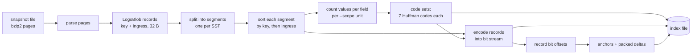

# vdisk-lsm-index-compress

Compresses the LogoBlob index records of a `ydb-dstool group take-snapshot`
file into a sorted, bit-packed array that can be searched by key without
unpacking it.

```
vdisk-lsm-index-compress compress --snapshot S --output IDX [--scope global|vdisk|sst]
                                  [--table all|fcur|fdreg|fold|level]
vdisk-lsm-index-compress find     --index IDX --tablet-id N --generation N --step N --channel N \
                                  --cookie N --blob-size N --part-id N [--crc-mode N]
vdisk-lsm-index-compress verify   --snapshot S --index IDX
vdisk-lsm-index-compress bench    --index IDX [--count N] [--seed S]
                                  [--plain-memory mmap|heap] [--plain-file PATH]
```

`bench` runs separately for every VDisk, as a request goes to one VDisk:
it takes N random records of the VDisk (uniform over its records) and
searches each key in the segments of that VDisk only, without printing.
The same search runs over plain sorted arrays of 44-byte records decoded
from the index, and the times are reported side by side. By default the plain arrays are
written to a file (`--plain-file`, default index path + `.plain`, deleted
after the run) and mapped into memory like the index; `--plain-memory heap`
keeps them on the heap instead.

## Pipeline



Sorting and encoding run once per segment; code sets are built once per
`--scope` unit.

## Segments and code sets

Records are always stored as separate segments: one per SST
`(GroupId, VDiskIndex, Level, SstId)` and one per fresh table of a VDisk.
Every segment has its own sorted array, offsets and record stream.

`--scope` sets which segments share one code set (7 Huffman codes):

| Scope | One code set per |
|---|---|
| `global` (default) | whole file |
| `vdisk` | VDisk |
| `sst` | segment |

```
┌────────┬───────────────────┬─────────────────────────────┬───────────┬─────┐
│ header │ code sets         │ directory                   │ segment 0 │ ... │
│        │ 0, 1, ...         │ id, code set, offset, size  │           │     │
└────────┴───────────────────┴─────────────────────────────┴───────────┴─────┘
                ▲                    │                           ▲
                └── code set number ─┴────── offset, size ───────┘

segment: ┌────────┬─────────┬────────┬───────────────┐
         │ header │ anchors │ deltas │ record stream │
         └────────┴─────────┴────────┴───────────────┘
```

`find` searches every segment, as a VDisk checks every SST.

## Record encoding

Each record is a variable-length bit string, MSB first, no byte alignment.
Fields go in key order, so a comparison can stop at the first differing
field. `H` means Huffman-coded, a number means a raw field of that width.

```
 key order ─────────────────────────────────────────────────────────►
┌──────────┬─────────┬────────────┬──────┬────────┬─────────┬──────────┬────────┬─────────┐
│ TabletId │ Channel │ Generation │ Step │ Cookie │ CrcMode │ BlobSize │ PartId │ Ingress │
│    H     │    H    │     H      │  H   │   H    │    2    │    H     │   4    │    H    │
└──────────┴─────────┴────────────┴──────┴────────┴─────────┴──────────┴────────┴─────────┘
```

The raw words of `TKeyLogoBlob` compare in this exact field order, so the
records sorted by raw words are also sorted by these fields.

## Huffman codes

One code per field: TabletId, Channel, Generation, Step, Cookie, BlobSize,
Ingress.

- Canonical code: codewords are assigned in (length, value) order, so only
  the lengths and the values are stored. Table format: varint symbol count,
  varint max length, varint count per length, then the values of each length
  as ascending varint deltas.
- Lengths are capped at 48 bits; if the cap is exceeded, frequencies are
  halved and the code is rebuilt.
- A field with one distinct value takes 0 bits.
- Decoding peeks `MaxLength` bits with one 8-byte load. Codewords up to
  10 bits are decoded by one lookup in a table indexed by the next 10 bits
  (entry: symbol index and length). Longer codewords: the first length
  where `code - FirstCode[len] < Count[len]` for the prefix of the peeked
  bits.

## Offsets

Records have different lengths, so record `i` cannot be found by
multiplication. Bit offsets are stored in two parts:

```
records   0   1   2  ...  63 │ 64  65  ...  127 │ 128 ...
          ▲                  │ ▲                │ ▲
anchors   A0 (ui64)          │ A1 (ui64)        │ A2 ...      one per 64 records

deltas        d1  d2 ... d63 │     d65 ... d127 │      ...    DeltaWidth bits each

          d_i = offset(i) - offset(i-1) - DeltaBase

offset(i) = A[i / 64] + Σ (d_j + DeltaBase),  j = 64·(i/64)+1 .. i
```

`DeltaBase` is the smallest record length and `DeltaWidth` is the bit
width of (largest − smallest) record length. Finding an offset reads one
anchor and at most 63 deltas; the first record of a block needs no deltas.

## File layout

Little-endian.

| Field | Type |
|---|---|
| Magic `VLSMHC05` | `char[8]` |
| Scope, reserved | `ui32`, `ui32` |
| CodeSetCount | `ui64` |
| Code sets: 7 Huffman tables each, `EField` order | `ui64` size + bytes per table |
| SegmentCount | `ui64` |
| Directory, ascending by id: GroupId, VDiskIndex, TableType, Level, SstId, code set number, reserved, offset, size | 48 B per segment |
| Segments | |

Segment:

| Field | Type |
|---|---|
| RecordCount | `ui64` |
| BlockSize (64), DeltaWidth | `ui32`, `ui32` |
| DeltaBase, StreamBits | `ui64`, `ui64` |
| AnchorCount, anchors | `ui64`, `ui64[]` |
| Packed deltas | `ui64` size + bytes |
| Record stream | `ui64` size + bytes |

## Search

`find` maps the file into memory and searches every segment:

1. Binary search over the first records of the 64-record blocks, reached
   directly through the anchors: the first block whose first record is not
   less than the key.
2. The offsets of the previous block are computed once from its deltas;
   binary search over its records gives the lower bound.
3. Records equal to the key follow the lower bound; they are scanned.

Each comparison decodes fields only up to the first one that differs from
the key. The bit reader loads 8 bytes at a time.

## Results

Checked on an index snapshot with the following properties: 8 VDisks, 653
segments (645 SSTs and 8 FCur tables), 19,652,363 records, 599.74 MiB as raw
32-byte records, 97.69 MiB as the bzip2 snapshot file.

bits per record:

| Part | global | vdisk | sst |
|---|---:|---:|---:|
| code sets | 1 | 8 | 653 |
| Step | 20.67 | 20.60 | 15.99 |
| Huffman tables | 0.97 | 6.86 | 13.57 |
| offset deltas | 6.02 | 5.94 | 5.72 |
| TabletId | 6.28 | 6.27 | 2.76 |
| Generation | 6.23 | 6.22 | 3.52 |
| Channel | 5.86 | 5.86 | 2.68 |
| Ingress | 5.61 | 5.52 | 4.83 |
| BlobSize | 4.53 | 4.50 | 3.72 |
| PartId (raw) | 4.00 | 4.00 | 4.00 |
| Cookie | 3.65 | 3.64 | 3.24 |
| CrcMode (raw) | 2.00 | 2.00 | 2.00 |
| offset anchors, directory, headers | 1.03 | 1.03 | 1.04 |
| **total** | **66.84** | **72.44** | **63.07** |
| size | 156.60 MiB | 169.71 MiB | 147.77 MiB |
| ratio vs raw records | 3.83 | 3.53 | 4.06 |
| ratio vs bzip2 file | 0.62 | 0.58 | 0.66 |

- `sst` is the smallest: one SST covers a narrow key range, so its codes
  are short, and that saves more than its tables cost (21.5% of the file).
- `vdisk` is the largest: its codes are no shorter than `global`, and the
  tables are 7 times larger.

`bench`, 100,000 keys per VDisk, each searched in the segments of its
VDisk only (68–161 segments). The plain baseline is the same segments
decoded into sorted arrays of 44-byte records (24-byte key + 20-byte
`TMemRecLogoBlob`) in a mapped file, searched with `std::equal_range`.
All keys of all 8 VDisks:

| | compressed, global | compressed, sst | plain 44 B |
|---|---:|---:|---:|
| data size | 156.60 MiB | 147.77 MiB | 824.65 MiB |
| find, mean | 25.0 us | 24.8 us | 3.45 us |
| find, p99 | 51.4 us | 45.9 us | 6.4–7.4 us |
| records compared per find | 954 | 954 | 1,698 |

The compressed index is about 5.5 times smaller and about 7 times slower
to search. Time grows with the number of segments of the VDisk: VDisk 6
has 161 segments and takes about twice as long as the others (68–76).

The sort order is not used: each field is coded on its own, so repeated
TabletId / Channel / Generation in adjacent records cost full codewords.
